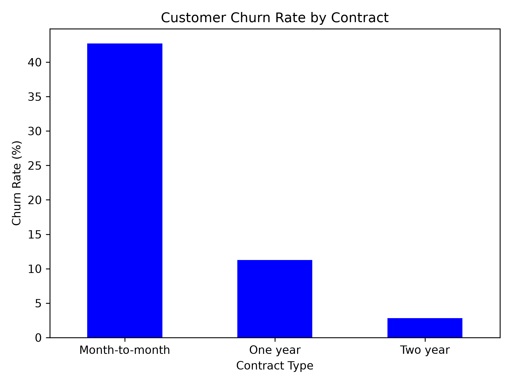
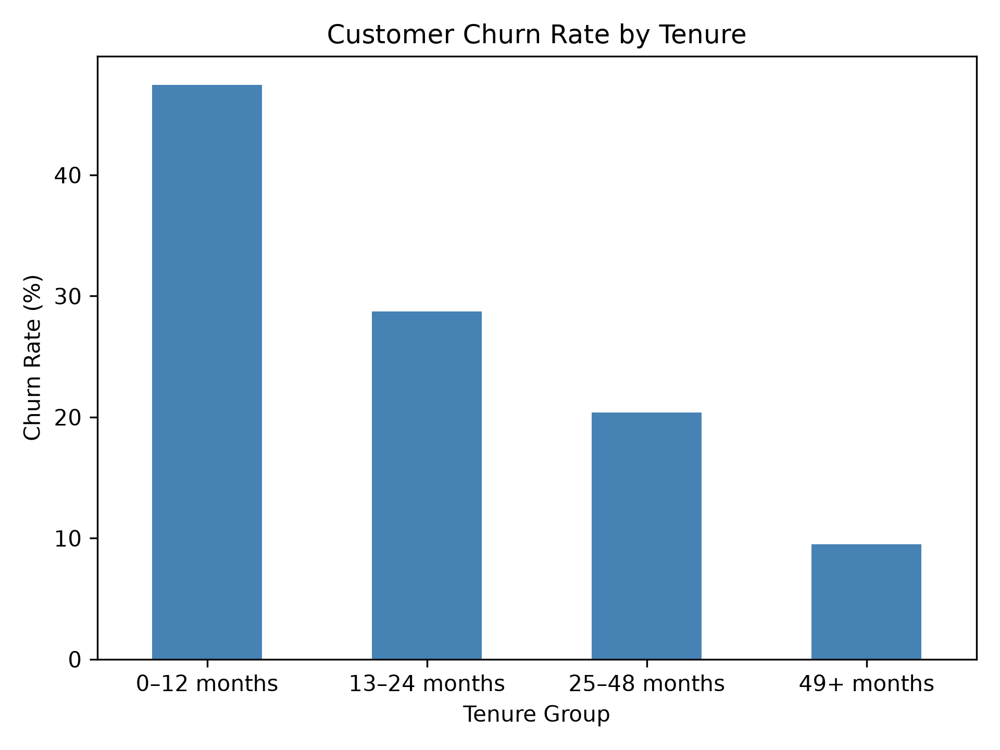
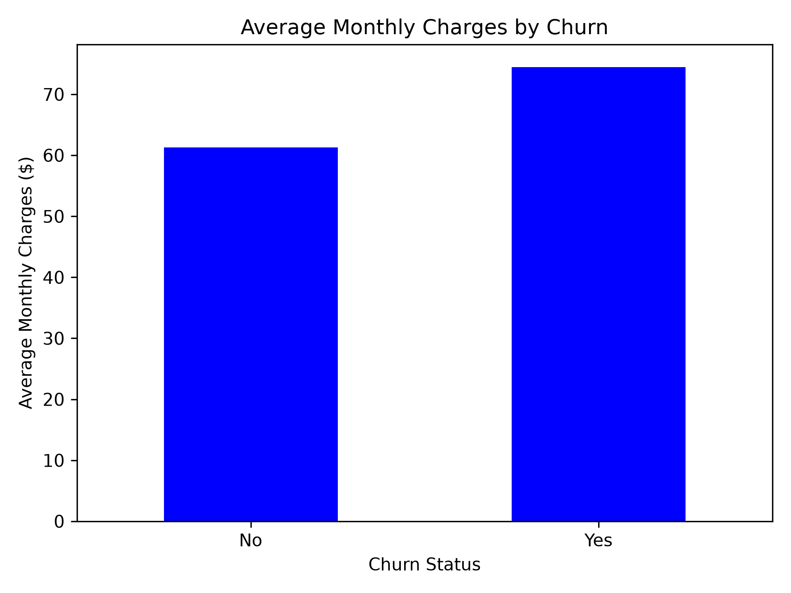

# Customer Churn Analysis

I built this project to practice cleaning and analyzing customer data with Python. I explored how churn differed by contract type, length of membership, and monthly charges.

## Tools
- Python
- pandas
- Matplotlib

## Questions
1. What percentage of customers left?
2. How did churn rates differ by contract type?
3. How did churn rates differ by tenure group?
4. How did average monthly charges compare between customers who stayed and those who left?

## Data Preparation
The dataset contains 7,043 customers.

I converted TotalCharges from text to numbers and found 11 missing values. All 11 customers had zero months of tenure. I kept these values as missing rather than assuming they were zero.

No duplicate customer IDs were found.

## Findings
- Overall churn was **26.54%**: 1,869 out of 7,043 customers.
- Month-to-month contracts had a **42.71%** churn rate, compared with **11.27%** for one-year and **2.83%** for two-year contracts.
- Customers with 0–12 months of tenure had a **47.44%** churn rate, compared with **9.51%** for customers with 49 or more months.
- Average monthly charges were **$74.44** for customers who left and **$61.27** for those who stayed.

These comparisons show associations in the sample data; they do not establish why customers left.

## Charts

### Churn by Contract


### Churn by Tenure


### Monthly Charges by Churn Status


## How to Run
Keep the original dataset at:

`Data/Telco-Customer-Churn.csv`

Install the required libraries:

```bash
python -m pip install pandas matplotlib
```

Run the analysis:

```bash
python main.py
```

Close each chart window to allow the script to continue. The script saves three charts and a prepared CSV in the outputs folder.

## Data Source
[IBM Telco Customer Churn sample dataset](https://github.com/IBM/telco-customer-churn-on-icp4d/blob/master/data/Telco-Customer-Churn.csv)

## Author
Farshad Rezaei
